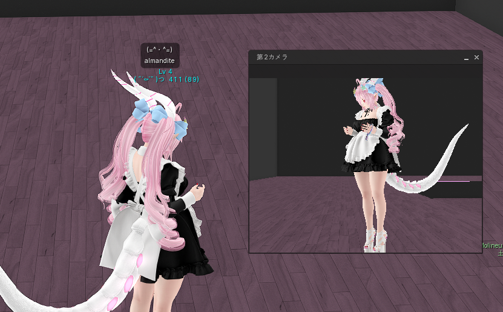

# SnowPastel Multi-View Viewer

**[Windows試用版 26.4.0.7 をダウンロード（説明書改訂版・ZIP・約264 MiB）](https://github.com/snowpastel/multi-view-viewer/releases/download/v26.4.0.7/SnowPastel-Multi-View-26.4.0.7-win64-guide2.zip)**

Windows x64用です。ZIPをすべて展開し、**「試用版を起動.cmd」** をダブルクリックしてください。設定とキャッシュは展開先の「試用データ」に保存されます。

[試用前のご案内（サポート・プライバシー・影の制限）](#試用前のご案内)

Second Lifeの公式Viewerをベースにした、SnowPastelの2画面表示実験です。メイン画面で後ろ姿を見ながら、小窓で正面の前髪や服装を確認できます。

*前後2画面の表示例（初期の実験画面）*

[▶ YouTubeで実験動画を見る「改造Second Life Viewer でのカメラを増やす実験」](https://www.youtube.com/watch?v=E-E9NdHK_o4)

## 初めて第2カメラを開く

1. ログイン後、メニューバーの「私」→「環境設定…」を選びます。Ctrl＋Pでも開けます。
2. 「アドバンス」タブで **「開発メニューを表示」** にチェックを入れ、「OK」を押します。
3. メニューバーに現れた **「開発」→「正面ビューを表示」** を選びます。
4. 「第2カメラ」の小窓で「顔」または「全身」を選びます。

## 26.4.0.7でできること

- 第2カメラの「顔」と「全身」を切り替えられます。顔アップでは、Shift＋ドラッグで構図を調整でき、小窓のサイズも変えられます。
- メインカメラを周囲に向けて自分が画面から外れても、小窓では自分のアバターを見続けられます。顔アップ・全身の両方で、鼻に着けた角や耳の飾りが頭の動きに追従することを確認しました。

## 試用前のご案内

**提供元とサポート**　SnowPastel Multi-View Viewer はSnowPastelが配布する実験用Viewerです。試用版のため、個別サポートと不具合報告の受付は行っていません。This software is not provided or supported by Linden Lab, the makers of Second Life.

**画面に表示される名前**　このWindows版では、ログイン画面のタイトルは「Second Life」です。版を確かめるには、ログイン前に「ヘルプ」→「Second Lifeについて」を開いてください。「情報」の先頭に `PJ0225 Dual View 26.4.0.7 (64bit)` と表示されます。`PJ0225 Dual View` はこの試用版の開発名です。

**プライバシーポリシー（26.4.0.7 Windows試用版）**　「試用版を起動.cmd」から起動すると、設定と動作ログは展開先の `試用データ/roaming/SecondLife`、キャッシュは `試用データ/local/SecondLife` に保存されます。会話ログを保存する場合の指定先は `試用データ/chat_logs`、一時ファイルは `試用データ/temp` です。ログイン情報の記憶はログイン画面で選べます。試用データを消す場合はViewer終了後に展開フォルダーを削除してください。他の人に渡すときは配布ZIPを使ってください。

ログインやワールドの表示にはSecond Lifeのサービスと通信します。試用版ランチャーはクラッシュレポーターと装着物の計測CSVを無効にしています。第2カメラの描画はこのPCで行い、SnowPastelが小窓の映像や会話ログを受け取る機能はありません。

**影の制限**　第2カメラでメインカメラとは違う方向を見ると、アバターから離れた床や物の影が、メイン画面と違う位置や形に見えることがあります。

## ベースとなった公式Viewer

以下はLinden Labの公式Viewerに関する資料です。ダウンロードリンクは公式版の配布先です。

<picture>
  <source media="(prefers-color-scheme: dark)" srcset="doc/sl-logo-dark.png">
  <source media="(prefers-color-scheme: light)" srcset="doc/sl-logo.png">
  
</picture>

**[Second Life][] is a free 3D virtual world where users can create, connect and chat with others from around the
world.** The upstream [secondlife/viewer](https://github.com/secondlife/viewer) repository contains the source code for the official client.

### Open Source

Second Life provides a huge variety of tools for expression, content creation, socialization and play. Its vibrancy is
only possible because of input and contributions from its residents. The client codebase has been open source since
2007 and is available under the LGPL license. The [Open Source Portal][] contains additional information about Linden
Lab's open source history and projects.

### Download

Most people use a pre-built viewer release to access Second Life. Windows and macOS builds are
[published on the official website][download]. More experimental viewers, such as release candidates and
project viewers, are detailed on the [Alternate Viewers page](https://releasenotes.secondlife.com/viewer.html).

#### Third Party Viewers

Third party maintained forks, which include Linux compatible builds, are indexed in the [Third Party Viewer Directory][tpv].

### Build Instructions

[Windows](https://wiki.secondlife.com/wiki/Build_the_Viewer_on_Windows)

[Mac](https://wiki.secondlife.com/wiki/Build_the_Viewer_on_macOS)

[Linux](https://wiki.secondlife.com/wiki/Build_the_Viewer_on_Linux)

### Contribute

Help make Second Life better! You can get involved with improvements by filing bugs, suggesting enhancements, submitting
pull requests and more. See the [CONTRIBUTING][] and the [open source portal][] for details.

[Second Life]: https://secondlife.com/
[download]: https://secondlife.com/support/downloads/
[tpv]: http://wiki.secondlife.com/wiki/Third_Party_Viewer_Directory
[open source portal]: http://wiki.secondlife.com/wiki/Open_Source_Portal
[contributing]: https://github.com/secondlife/viewer/blob/main/CONTRIBUTING.md
